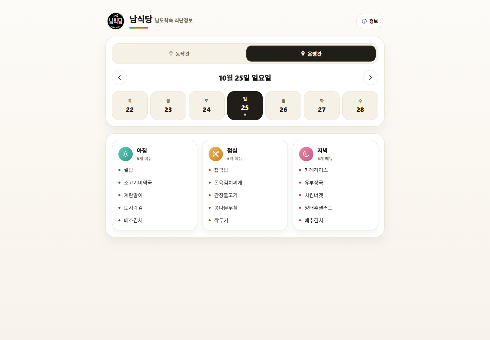
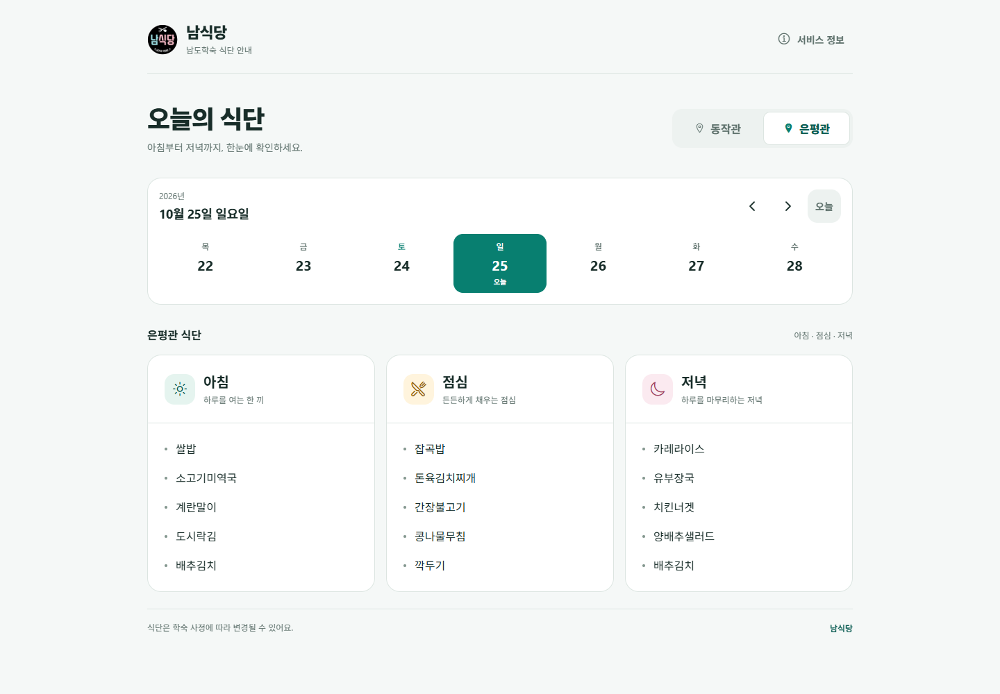
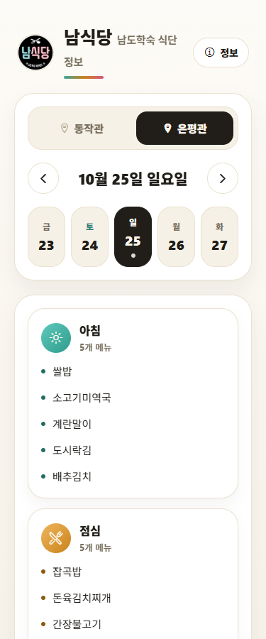
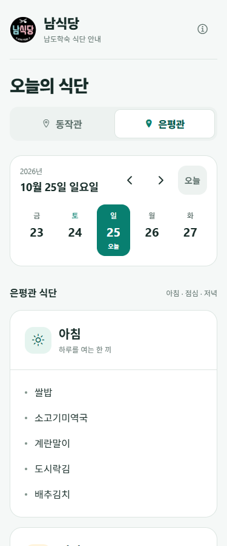
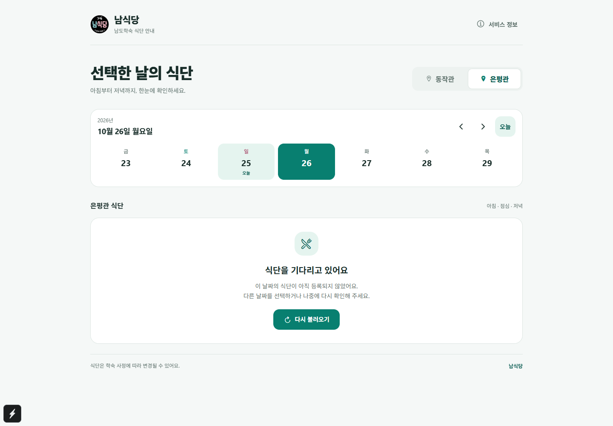
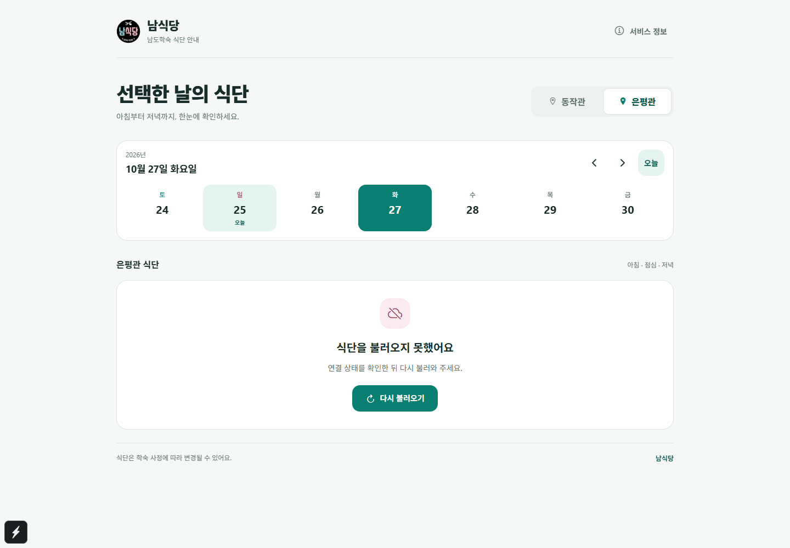
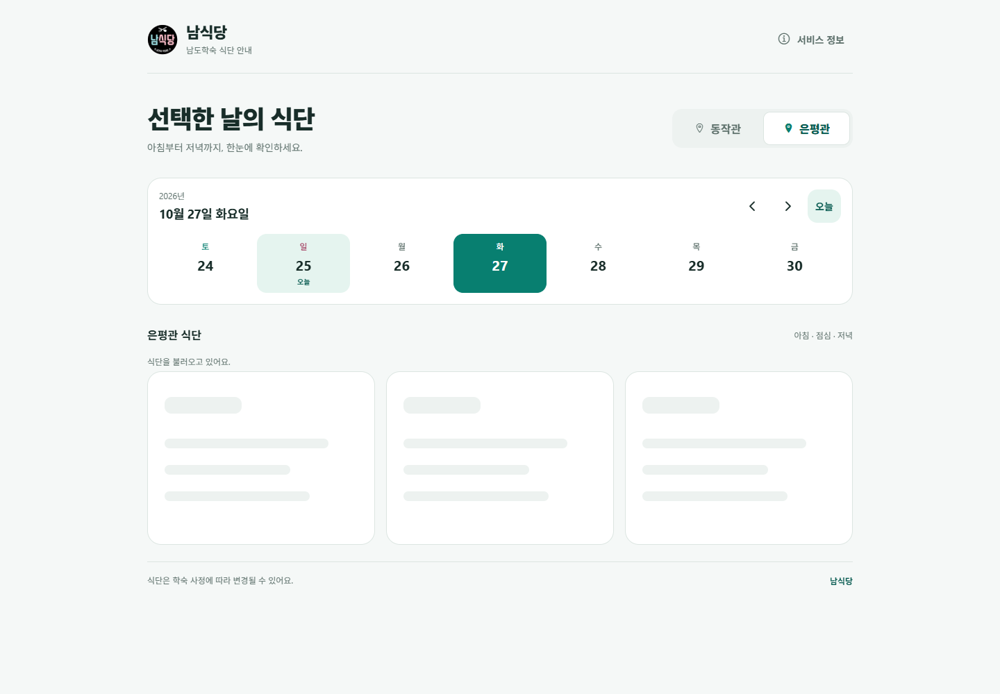
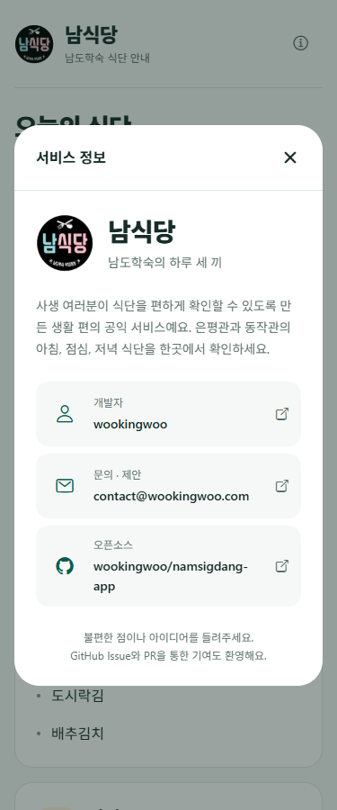

# 남식당 UI·UX 검증 기록

검증일: 2026-10-25 (Asia/Seoul). Gitflow: `feature/menu-experience` → `develop`.

## 화면 비교

이 폴더의 이미지는 실제 Expo 웹 화면을 브라우저로 렌더링해 촬영한 결과다. 식단은 **화면 비교를 위한 테스트용 예시**이며 해당 날짜의 운영 식단이 아니다. 변경 전후 모두 같은 은평관·2026년 10월 25일·같은 예시 메뉴를 사용했다. 기존 로고와 Ionicons를 사용했으며 이미지를 합성하거나 생성하지 않았다.

변경 전 소스: `caa1b78`. 최종 촬영 소스: `982b09c`.

| 화면 | 변경 전 | 변경 후 |
| --- | --- | --- |
| 데스크톱 1440 × 1000 |  |  |
| 모바일 375 × 900 |  |  |

모바일 앱의 내부 스크롤 영역 때문에 375 × 900 이미지는 첫 화면을 기록한다. [375px 폭 전체 배치](after-mobile-full.png)는 높이 1700px의 브라우저에서 촬영했다. 실제 휴대전화 화면 높이를 나타내는 이미지는 아니다.

| 미등록 | 오류와 재시도 | 정적 로딩 |
| --- | --- | --- |
|  |  |  |

## 자동 테스트와 빌드

| 검증 | 결과 |
| --- | --- |
| `npm test` | CLI 13개 + 소스 86개, 총 99개 통과 |
| `npm run test:coverage` | 동일 99개 통과, `date.ts`, `menu.ts`, `firebase.ts` 파일별 줄·구문·함수·분기 100% 유지 |
| `npm run typecheck` | 통과 |
| `npm run build:web` | Firebase 설정 검증 및 프로덕션 웹 내보내기 통과 |
| `git diff --check` | 통과 |

Windows 샌드박스의 임시 SSR 캐시 rename 제한 때문에 테스트는 호스트 권한으로 실행했다. Expo의 기존 버전 권장 경고 및 터미널 색상 환경 변수 경고는 빌드를 실패시키지 않았다. 의존성 변경은 없다.

## 실제 화면에서 확인한 동작

- 관 전환과 AsyncStorage 저장, 웹 탭의 방향키 이동, 선택 상태 노출.
- 이전·다음 날짜, 오늘 복귀, 항상 같은 위치에 있는 오늘 버튼, 선택된 날짜 읽기.
- ±3개월 양 끝 날짜에서 이전·다음 버튼의 비활성 상태. 달력의 세부 경계는 기존 단위 테스트로 별도 검증한다.
- 오류 후 관·날짜를 유지한 재시도와 오류 해제.
- 재시도가 진행 중일 때 날짜를 바꾼 뒤 이전 응답이 늦게 도착해도 새 식단을 유지.
- 관을 바꾼 뒤 이전 날짜 요청의 응답이 늦게 도착해도 새 관의 식단을 유지.
- 로딩 상태 안내와 정적 자리표시자, 하루 전체 미등록, 한 끼만 미등록.
- 서비스 정보의 열기·닫기·Escape·포커스 복귀, Tab 8회 동안 모달 내부에 머무르는 포커스, 링크 역할 3개.
- 375 × 900, 768 × 1024, 1440 × 1000, 844 × 390에서 가로 넘침 없음. 날짜 화살표의 조작 영역 48 × 48px 이상.
- 브라우저 텍스트 200% 확대 시 가로 잘림 없음. 이것은 네이티브 Dynamic Type 실행 검증과 구별한다.
- 실제 렌더링 색상의 대비: 메뉴 본문 14.52:1, 브랜드 설명 4.92:1, 끼니 설명 5.26:1, 선택된 오늘 표시 4.65:1.
- reduced motion 설정에서 동작 확인. 로딩에 반복 애니메이션을 사용하지 않는다.
- 콘솔의 오류는 테스트가 의도적으로 주입한 `Review: simulated offline`뿐이었다. 사용자 화면에는 내부 오류나 설정값을 표시하지 않는다.

## 재현 방법

`npm run web -- --port 8098`로 앱을 실행한 뒤 Playwright MCP의 `browser_navigate`로 `http://localhost:8098`을 연다. 이어 `browser_run_code_unsafe` 도구에 다음 파일을 `filename`으로 순서대로 전달한다.

1. [browser-checks.js](browser-checks.js): 네트워크 서비스의 개발 번들 export만 브라우저 안에서 대체한다. 실제 React 화면·훅·날짜·저장소는 그대로 실행한다. 재시도·경합·화면 크기·키보드를 검증한다.
2. [browser-accessibility.js](browser-accessibility.js): 2026년 10월 25일 선택 상태에서 브라우저 시계를 바꿔 양 끝 제한을 확인하고, 대비·텍스트 확대·모달 포커스를 검증한다.
3. [browser-native-focus.js](browser-native-focus.js): 앱의 Android 플랫폼 분기를 실제 웹 렌더러에서 실행해 두 관이 키보드 포커스를 받을 수 있는지 검사한다.
4. [capture-screenshots.js](capture-screenshots.js): 정상·피드백·정보 화면을 재촬영한다.

각 스크립트는 `PASS` 또는 검증 실패를 반환한다. 화면 스크립트는 Metro 개발 번들 전용이며 `npm test`나 GitHub Actions에 포함되는 자동 E2E 테스트가 아니다. 테스트용 식단·플랫폼 대체는 브라우저 세션 안에만 존재하고 앱 소스나 프로덕션 번들에 포함되지 않는다. 브라우저를 새로고침하면 서비스 대체가 사라진다.

## 독립 리뷰와 한계

`caa1b78..69b6650`을 독립적인 읽기 전용 코드 리뷰로 검사했다. Android에서 웹용 `tabIndex=-1`이 선택되지 않은 관의 포커스를 막는 문제를 발견했고, 설치된 React Native 0.81의 View 매핑을 확인했다. `browser-native-focus.js`에서 수정 전 실패(은평관으로 건너뜀) → 수정 후 성공(동작관, 은평관 순서)을 확인하고 `982b09c`에서 고쳤다. 추가로 재시도 도중 날짜 변경 경합을 검증했다.

실제 iOS/Android 기기·시뮬레이터의 렌더링, 화면 읽기 프로그램, Android 뒤로가기와 네이티브 글자 확대는 실행하지 않았다. 네이티브 포커스 검증은 앱의 플랫폼별 props 회귀와 설치된 소스 확인이며 실기 실행을 대신하지 않는다. 실시간 Firestore 가용성·운영 데이터도 검증 범위에 포함하지 않는다. 이 PR은 Firestore 경로, 환경 설정, 관 저장 키, 날짜 제한, 운영 배포를 바꾸지 않는다.
